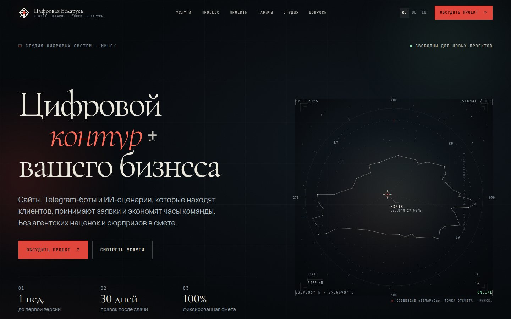

## About

### Description

«Цифровая Беларусь» is the website of an independent digital studio in Minsk. It sells websites, Telegram bots, AI assistants and automation to Belarusian businesses: a fast multi-page site in Russian, Belarusian and English with a transparent pricing calculator and a brief that is handed off to Telegram.

The visual language is a warm two-colour observatory: near-black ink and archival cream paper, a pixel-serif display face generated from Cormorant Garamond, a pixel mono (Handjet) for the interface and body, and 1-bit dithered imagery (NASA lunar photography, archival star charts, Belarusian craft, a pixel-art bot interface). Sections alternate full ink and full cream surfaces; there is no accent hue anywhere. Belarus is still present through the pixel rushnyk mark, ornament rules and the Minsk/53.9006°N read-outs.



### Technologies

Development: Visual Studio Code, Artificial intelligence assistance  
Framework: Next.js 16 (App Router), React 19, TypeScript (strict)  
Internationalisation: next-intl 4 — Russian (`ru`), Belarusian (`be`), English (`en`)  
Styling: hand-written CSS Modules, CSS custom properties, design tokens  
Design system: custom pixel-serif masks (generated from Cormorant Garamond), Handjet pixel mono, pixel mark and rushnyk rules, 1-bit dithered imagery  
Graphics: inline SVG, generated pixel assets, archival public-domain photography  
Formatting and checks: Prettier, ESLint, TypeScript, Vitest, custom i18n parity script  
Deployment: Vercel (fully static pre-rendering, no runtime dependencies)  
Version control: Git, GitHub

### Documentation

- [AGENTS.md](AGENTS.md) — project guide for artificial-intelligence agents
- [docs/specs](docs/specs) — feature specifications and acceptance criteria
- [docs/decisions](docs/decisions) — architecture decision records
- [docs/design](docs/design) — visual language, pixel type, ornament, image credits
- [docs/content](docs/content) — translation policy and glossary
- [docs/qa](docs/qa) — verification reports and production screenshots
- [docs/ops](docs/ops) — deployment and operations

## State

### Path

Built with DeepSeek Harness and an Agent Team (lead, designer, frontend, content, deployment).

1. Defined the studio positioning, services, packages, cases and FAQ based on the "website, bots and AI for local business" model
2. Built the first observatory identity and launched the trilingual site
3. **v2 redesign:** moved from the cold serif/red/green system to a strict warm two-tone world — generated pixel-serif headings, Handjet pixel body, dithered 1-bit imagery, cream/ink editorial sections, no accent hues
4. Implemented the trilingual landing page, pricing calculator, case dialogs and Telegram brief handoff
5. Added SEO (per-locale metadata, hreflang, sitemap, OG images), accessibility and reduced-motion support
6. Documented the architecture, design system, content policy and deployment
7. Published the repository on GitHub and launched production on Vercel with automatic deploys from `main`

### Pages

| Route                                                                 | Contents                                                                                |
| --------------------------------------------------------------------- | --------------------------------------------------------------------------------------- |
| `/{locale}`                                                           | Home: hero, manifesto, services, process, cases, pricing, reasons, studio, FAQ, contact |
| `/{locale}/services`                                                  | Services hub                                                                            |
| `/{locale}/services/{websites,bots,ai,automation,commerce,analytics}` | Six service detail pages                                                                |
| `/{locale}/cases`                                                     | Projects hub                                                                            |
| `/{locale}/cases/{yasna,central-park,spadchyna,prabot}`               | Four case-study pages                                                                   |
| `/{locale}/pricing`                                                   | Pricing and calculator                                                                  |
| `/{locale}/calculator`                                                | Standalone calculator                                                                   |
| `/{locale}/about`                                                     | Studio, approach, principles and founder                                                |
| `/{locale}/faq`                                                       | All questions                                                                           |
| `/{locale}/contact`                                                   | Contact channels and brief form                                                         |
| `/{locale}/privacy`                                                   | Data policy                                                                             |

### To-dos

- Add real client testimonials and replace the two concept cases when commercial projects are available
- Replace the concept imagery with real client photography when it exists
- Add automated visual regression and Lighthouse checks to CI
- Wire the brief form to a serverless Telegram delivery endpoint (optional; the current flow uses a safe client-side handoff)
- Consider a custom domain

## Usage

### Requirements

Node.js 24+, pnpm 11+.

### Install

```bash
pnpm install
```

### Run

```bash
pnpm dev          # http://localhost:3000 → redirects to /ru
```

### Build

```bash
pnpm build        # production build, all three locales pre-rendered
pnpm start        # serve the production build
```

### Check

```bash
pnpm check        # typecheck + lint + locale parity + unit tests
pnpm format       # write Prettier formatting
```

### Regenerate art

```bash
python3 scripts/generate-pixel-type.py   # pixel-serif heading masks (requires Cormorant TTF, downloaded on first run)
python3 scripts/generate-pixel-images.py # dithered hero, portrait, case and atlas imagery
python3 scripts/generate-og.py           # per-locale Open Graph images
python3 scripts/generate-brand-assets.py # favicon and app icons
```

Run `generate-pixel-type.py` after changing any display heading copy; it reads `messages/*.json` and writes `public/type/**` plus `src/content/pixel-type.json`.

### Visit

Production: [https://digital-belarus.vercel.app](https://digital-belarus.vercel.app)

The site is deployed on Vercel (project `digital-belarus`, team `kuzminklk-projects`) and the GitHub repository is connected: every push to `main` triggers a production deployment. See [docs/ops/vercel-deployment.md](docs/ops/vercel-deployment.md).

### Clone

```bash
git clone https://github.com/kuzminklk/digital-belarus
```

## Structure

```text
messages/            ru.json (source), be.json, en.json — every user-facing string
public/
  fonts/             Handjet WOFF2 subsets
  type/              generated pixel-serif masks per locale
  pixel/             dithered 1-bit imagery (hero, portrait, cases, atlas)
  og/                per-locale Open Graph images
  brand/             mark source
scripts/             i18n check, pixel type generator, image/OG/icon generators
src/app/[locale]/    locale layout; home, services, cases, pricing, calculator,
                     about, faq, contact, privacy and 404 routes
src/components/
  brand/             pixel mark, pixel type, rushnyk, icons
  layout/            header, footer, grain
  sections/          hero and all content sections
  ui/                section heading, reveal, arrows
src/content/         language-independent data (Belarus outline, type manifest)
src/i18n/            routing, request config, navigation helpers
src/lib/             site constants, navigation, SEO helpers, pricing calculator logic
src/content/pages.ts route slugs, case-image mapping and hub path list
src/styles/          fonts, design tokens, base layer, shared primitives
tests/               unit tests for pure logic
docs/                specs, decisions, design, content, qa, ops
```

## Content & language policy

The user-facing content is Russian, Belarusian and English; code, comments and documentation are English. Russian is the primary catalogue and the source for translations. The brand is «Цифровая Беларусь» in Russian, «Цыфровая Беларусь» in Belarusian and "Digital Belarus" in English. See [docs/content](docs/content) and [docs/decisions/0003-message-catalogs-as-content.md](docs/decisions/0003-message-catalogs-as-content.md).

## Credits

Design direction inspired by the [NOCTRA Observatory website concept](https://www.behance.net/gallery/248063485/NOCTRA-Observatory-Website-Design-UXUI); content structure inspired by [Volga Digital](https://volga-digital.ru/). Imagery: NASA Apollo 17 (public domain), Cellarius _Atlas Coelestis_ (CC0/BL), CC0 and CC BY-SA 4.0 sources documented in [docs/design/image-credits.md](docs/design/image-credits.md). Typefaces: Cormorant Garamond and Handjet, SIL Open Font License. Founder portrait: the founder's GitHub avatar.

## License

MIT — see [LICENSE](LICENSE).
