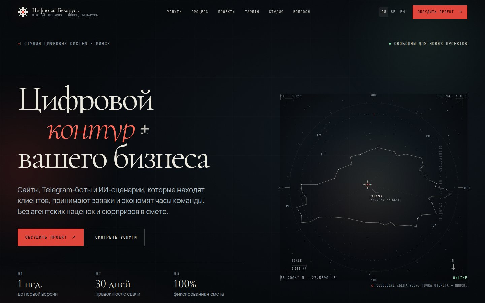
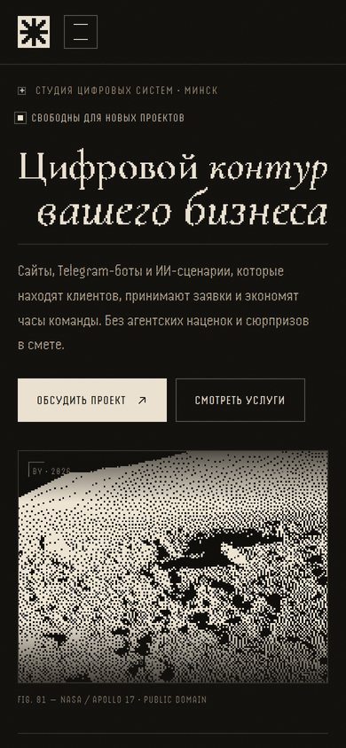
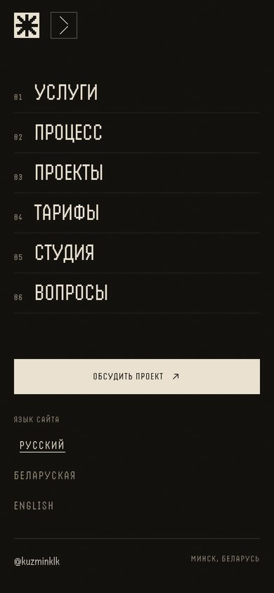
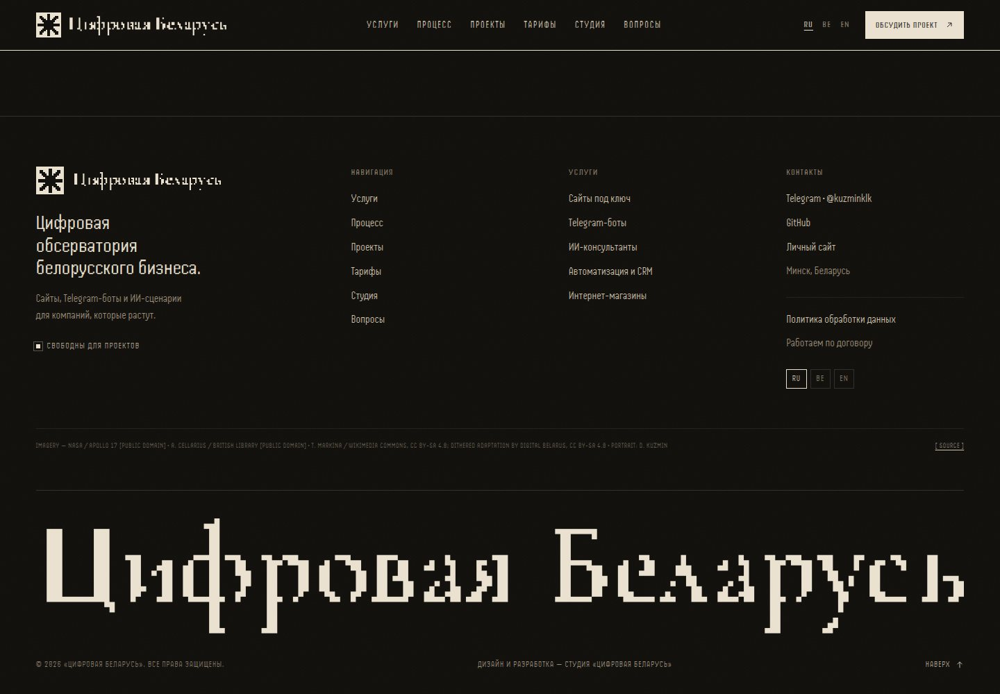

# Pre-launch QA — 26 November 2026 (v2 redesign)

Environment: production build (`pnpm build` + `next start`), headless Chrome 142, Playwright, axe-core 4.11. Viewports 1440×900 and 390×844, reduced motion on/off. The v1 report was replaced after the warm two-tone redesign.

  
  
  

## Automated checks

| Check                                     | Result                                                         |
| ----------------------------------------- | -------------------------------------------------------------- |
| TypeScript `tsc --noEmit`                 | pass                                                           |
| ESLint                                    | pass                                                           |
| `check-i18n` (ru/be/en, 491 strings)      | pass                                                           |
| Vitest (pricing logic)                    | 5/5 pass                                                       |
| `next build` (11 static routes)           | pass                                                           |
| axe-core WCAG 2.1 A/AA, all locales       | **0 violations**                                               |
| Lighthouse (desktop, /ru, local)          | Performance 89, Accessibility 100, Best Practices 100, SEO 92* |
| Console errors on /ru, /be, /en           | none                                                           |
| Horizontal overflow at 390 px and 1440 px | none                                                           |
| Lazy images loaded after scroll           | hero, atlas, portrait, four case covers — all 200              |

\* The local SEO score is 92 because the canonical points at the production domain while Lighthouse is measuring `localhost`; the audit passes on the deployed domain.

## What was verified

### Locales

- RU/BE/EN render the full page from localized catalogues; titles, descriptions, OG locale and `hreflang` alternates are correct.
- Language switcher preserves the path (`/ru/privacy` → `/be/privacy`).
- Belarusian renders `ў`, `і`, `ё` and `’` with the Handjet and pixel-serif assets.
- `<html lang>` matches the active locale.

### Layout and design system

- Two-tone inventory: no red, green, gold, blue or grey-blue appears in UI or imagery; imagery is exactly two colours.
- Pixel-serif masks render in every locale; cream and ink section headings invert correctly, including the previously invisible section indices on cream surfaces.
- Handjet body/labels are legible at 390 and 1440 px; no horizontal overflow.
- Mobile menu now covers the full viewport, keeps the logo and close control visible, and exposes the language switcher (a `backdrop-filter` containing-block bug was found and fixed).
- Hero title lines shrink inside the flex container on narrow screens; no clipped glyphs.
- Atlas plate is softened with opacity; all four case images and the portrait are dithered and pixel-crisp.
- Visible image credits in the footer satisfy the CC BY-SA 4.0 attribution for the Spadchyna ceramics source, with the licence link.

### Interactions

- Case cards open one native `<dialog>` (mouse and Enter); Escape, close button and backdrop close it and return focus.
- Calculator math is correct: landing 1 500 / 10 days → corporate + design 4 300 / 30 days; reset restores defaults; result is announced via `aria-live`.
- FAQ details open from the keyboard.
- Brief form validates three empty fields, opens Telegram, copies the structured request and shows the success panel; fallback copy is shown if clipboard access fails.
- Mobile menu opens, locks background scroll, closes on Escape and routes locale changes correctly.

### Accessibility

- Skip link, landmarks, one h1 per page, focus states, 200% zoom and reduced motion checked.
- Generated type masks are `aria-hidden`; real heading text lives in `.sr-only` nodes.
- Fixed in this pass: footer credit contrast (opacity removed), mobile menu stacking, cream section index contrast, hero accessible name.
- axe-core: 0 violations on all three locales.

## Known limitations

- Two concept cases are clearly labelled and have no external URL; live cases link to real projects.
- The brief form does not post to a server; this is a privacy decision (ADR 0006), with a visible Telegram fallback.
- Handjet is unusually characterful for long body copy; it was selected deliberately and checked at small sizes.
- The moon panorama crop is tuned to the local high-resolution NASA source; regenerating from the script's fallback image may need crop retuning (documented).

## Production verification

- V2 deployed to Vercel as project `digital-belarus`; production URL https://digital-belarus.vercel.app; Git integration connected to `kuzminklk/digital-belarus` (production branch `main`). Committed as `77bb5ba` and deployed automatically from `main`.
- Canonical, `hreflang` and `og:url` resolve to the production domain through `VERCEL_PROJECT_PRODUCTION_URL` at build time; live `<link rel="canonical">` verified as `https://digital-belarus.vercel.app/ru`.
- **Lighthouse against production (`/ru`): Performance 86, Accessibility 100, Best Practices 100, SEO 100.** FCP 2.6 s, LCP 2.8 s, CLS 0, TBT 260 ms, 329 KiB transfer.
- Live interaction pass: mobile menu covers the full 844 px viewport, case dialog opens, calculator computes the corporate-site price (3 500 BYN / 25 days), no console errors. The visible footer credits include the CC BY-SA 4.0 attribution for the Spadchyna ceramics source.
- Security headers verified live: HSTS, `X-Content-Type-Options`, `X-Frame-Options`, `Referrer-Policy`, `Permissions-Policy`.
