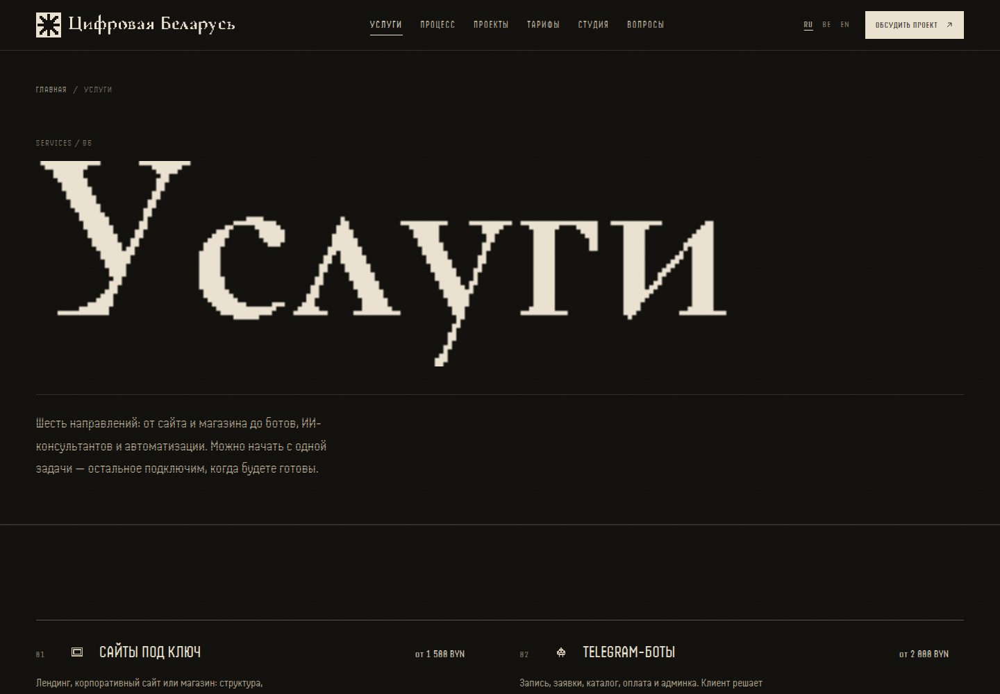
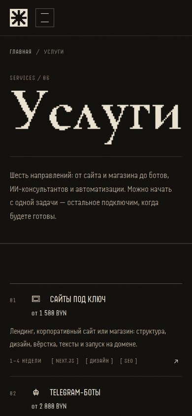
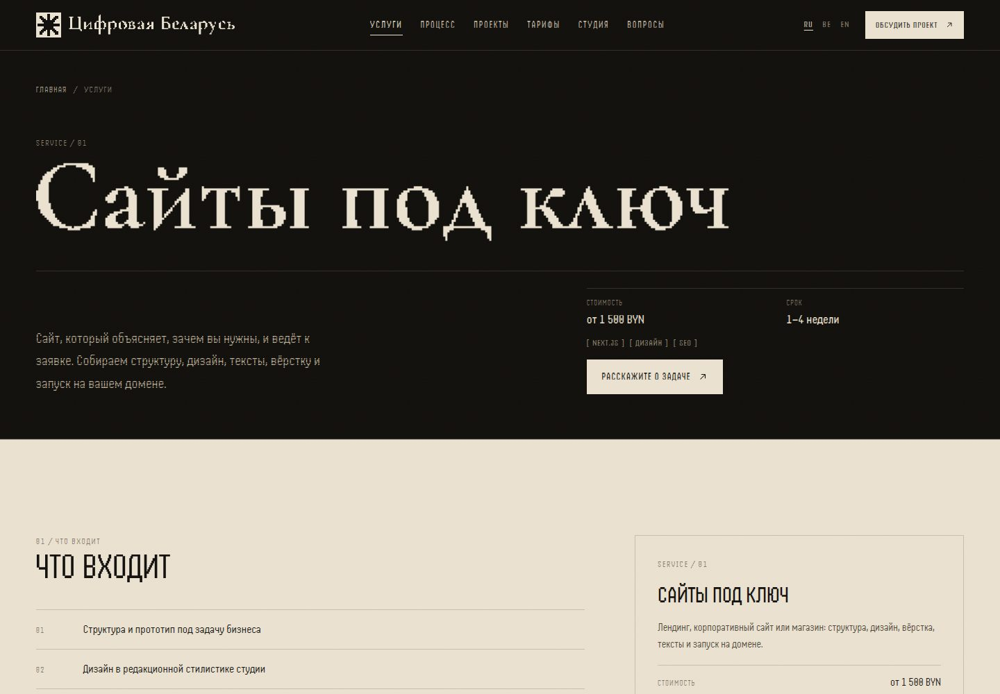
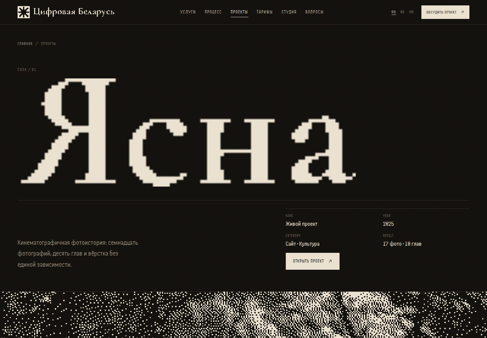
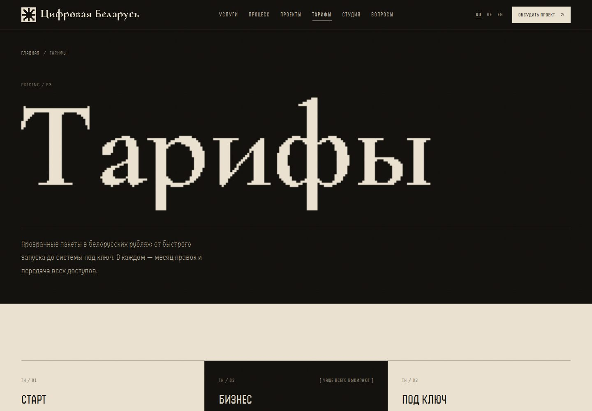
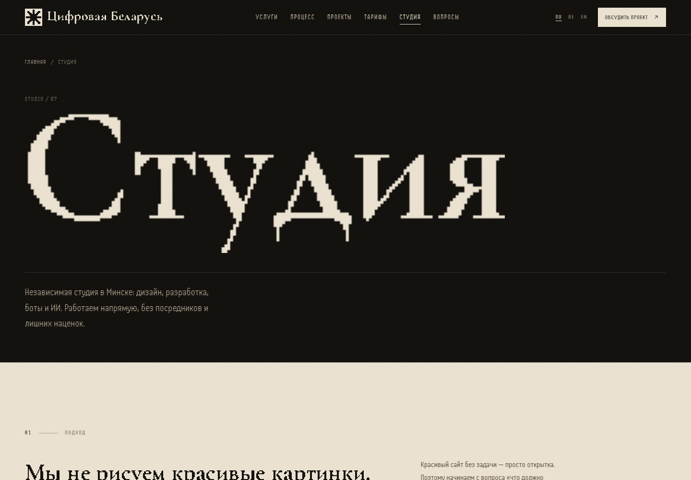

# QA — type legibility + multi-page routes (27 November 2026)

Environment: production build, headless Chrome 142 (Playwright), axe-core 4.11, Lighthouse. Viewports 1440×1000 and 390×844 (390×844 with DPR 2 for screenshots). Reduced motion enabled during audits.

  
  
  

## 1. Cyrillic pixel-serif legibility

The screenshot feedback was addressed without changing the typeface:

- Display masks now use a **2 px pixel grid** (previously 2–4 px) with a denser logical render, a slightly bolder Cormorant instance and modest letter tracking.
- Section headings grew from 36–40 px to 46 px cap height; the print-like pixel edges remain but the internal letterforms have roughly twice the detail.
- The header wordmark grew from 16 px to 24 px, gained tracking and is hidden below 1120 px instead of shrinking into illegibility.
- Editorial headings ship a **narrow-screen mask** (42 px, 2 px grid, more wrapped lines) shown below 700 px. This specifically fixes the mobile Cyrillic case: headings now break into 2–3 readable lines instead of one small strip.
- `PixelType` renders both variants and picks one with CSS; the real text stays in the accessible `.sr-only` node.

All masks were regenerated for ru/be/en (33 entries per locale) with `python3 scripts/generate-pixel-type.py`.

## 2. Route expansion

| Check                                 | Result                                                                                 |
| ------------------------------------- | -------------------------------------------------------------------------------------- |
| Statically generated routes           | 19 paths × 3 locales = **57 URLs**                                                     |
| Hubs                                  | `/services`, `/cases`, `/pricing`, `/calculator`, `/about`, `/faq`, `/contact`         |
| Detail routes                         | 6 services, 4 case studies                                                             |
| HTTP status, all 57 URLs              | 200                                                                                    |
| Unknown service/case slug             | localized 404                                                                          |
| Sitemap                               | 57 `<url>` entries with hreflang alternates                                            |
| Canonical + 3 hreflang, sampled       | services hub, service detail, cases hub, case detail, all locales                      |
| Console errors                        | none                                                                                   |
| Horizontal overflow, 390 px / 1440 px | 0 on every route                                                                       |
| axe-core WCAG 2.1 A/AA (new routes)   | **0 violations**                                                                       |
| Header active state                   | correct for hub and detail descendants                                                 |
| Navigation                            | header routes, footer routes, home CTAs, service cards, case-dialog case link verified |
| Unknown dynamic content               | `dynamicParams = false`, no accidental pages                                           |

## 3. Content and i18n

- 554 strings in each catalogue; `pnpm check:i18n` green.
- New page copy lives under `pages.*` and `servicePages.*`; slugs are language-independent in `src/content/pages.ts`.
- Page metadata is localized for all hubs and every generated detail page; titles follow `Page — Digital Belarus` / `Старонка — Цыфровая Беларусь`.
- Case and service H1s use generated masks from the same catalogue strings, so text and mask cannot drift apart.

## 4. Production verification

- Deployed from `main` as Vercel production commit **`489567f`** (automatic Git deployment); project `digital-belarus`, URL https://digital-belarus.vercel.app.
- All 19 paths return 200 for ru/be/en (57 URLs); unknown service/case slugs return the localized 404.
- Live canonical/hreflang verification on sampled hub and detail pages: one canonical and three `hreflang` alternates per page, pointing at the production domain.
- Live axe-core WCAG 2.1 AA: **0 violations** on 11 sampled routes across ru/be/en.
- Live functional pass: case dialog opens; header routes and case-dialog case page link navigate correctly; mobile menu is 844 px tall (full viewport); no console errors; no horizontal overflow.
- **Lighthouse production (`/ru`): Performance 86, Accessibility 100, Best Practices 100, SEO 100.** FCP 2.7 s, LCP 3.0 s, TBT 210 ms, CLS 0, 401 KiB transfer.
- Security headers unchanged and verified in the previous deployment report.

The previous v2 production baseline is recorded in [2026-11-26-launch.md](2026-11-26-launch.md).
